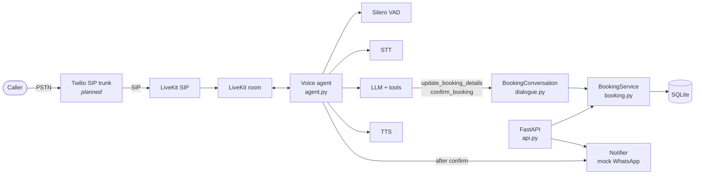

# AI Voice Receptionist for Indian Businesses

**A multilingual phone receptionist for clinics, salons and small shops: Hindi, English and Hinglish, with appointment booking.**


> **Status: early-stage prototype.** The booking engine, API and a LiveKit agent skeleton exist and are tested.
> Telephony, WhatsApp delivery and latency tuning are **not done**. This is not production-ready, has no
> users, and no performance has been measured. See [Project status](#project-status).

Independently developed by an IIT Madras BS Data Science student. This is a personal project; it is not
affiliated with or endorsed by IIT Madras.

## Problem

Small Indian businesses lose bookings when the phone rings during a consultation or a haircut. Callers mix
Hindi and English mid-sentence, give times like "kal shaam 4 baje", and expect a quick answer. Missed calls
and hand-written diaries mean missed or double-booked appointments.

## Proposed solution

An AI agent that answers the call, speaks the caller's language, collects name, phone number, service and
time, reads the details back, accepts corrections, checks them against the business's hours and existing
bookings, and saves the appointment. A WhatsApp confirmation follows.

The design principle: **the LLM handles the conversation, plain Python owns the facts.** The LLM never writes to the
database. It calls two tools; deterministic code validates phone numbers, opening hours, service names and slot
conflicts.

## Key features

| Feature | State |
|---|---|
| Business profile (name, services, hours, FAQs, capacity) from JSON or env | Implemented |
| Structured appointment models, Indian phone normalisation (`+91…`) | Implemented |
| Booking with opening-hours and overlap checks, SQLite persistence | Implemented |
| Incremental extraction, corrections, read-back before confirm | Implemented |
| FastAPI `/health` and appointment endpoints | Implemented |
| Scripted local demo (no API keys) | Implemented (simulated conversation) |
| LiveKit voice agent: Silero VAD → STT → LLM tools → TTS, barge-in enabled | Implemented, **untested against live services** |
| WhatsApp confirmation | **Mock only** (logs, sends nothing) |
| Inbound phone calls (Twilio SIP → LiveKit) | **Not implemented** (documented design) |
| Hindi/Hinglish quality tuning, latency benchmarks | **Not done** |

## Architecture



Details: [docs/ARCHITECTURE.md](docs/ARCHITECTURE.md).

## Technology stack

Python 3.11+, [LiveKit Agents](https://docs.livekit.io/agents/) (1.x), OpenAI plugins for STT/LLM/TTS (the only
wired provider; the registry in `agent.py` is the extension point), Silero VAD, FastAPI, Pydantic v2, SQLite
(stdlib), pytest, ruff. Twilio is planned for telephony and WhatsApp, not integrated yet.

## Quick start

```bash
python3.11 -m venv .venv && source .venv/bin/activate
pip install -e ".[dev]"            # API, demo and tests
pip install -e ".[dev,agent]"      # also installs LiveKit packages for the voice agent
cp .env.example .env               # only needed for the live agent
```

Run the API (uses a SQLite file at `data/appointments.db`):

```bash
uvicorn voice_receptionist.api:create_app --factory --reload
```

Then open <http://127.0.0.1:8000/docs>. There is no authentication yet; do not expose it publicly.

## Local demo (no API keys)

```bash
python -m voice_receptionist.demo
```

This replays a scripted Hinglish booking with a mid-call correction. **There is no speech or LLM involved**:
the extracted fields are hand-written stand-ins for LLM tool calls. Validation, correction handling, SQLite
persistence and the mock WhatsApp message are real code.

## Running the live voice agent (needs accounts)

Requires `LIVEKIT_URL`, `LIVEKIT_API_KEY`, `LIVEKIT_API_SECRET` and `OPENAI_API_KEY` in `.env`.

```bash
python -m voice_receptionist.agent console   # talk through your local mic/speaker
python -m voice_receptionist.agent dev       # worker that joins LiveKit rooms
```

These commands follow the LiveKit Agents CLI but have **not been run end to end** yet,
because that needs paid accounts. Treat the first run as an integration test.

## Testing

```bash
pytest          # 39 tests, no network or keys
ruff check .
ruff format --check .
```

`tests/test_agent.py` only checks that the agent module imports and registers its tools against the installed
SDK; it does not exercise audio or the LLM.

## Example booking workflow

```
Caller : Namaste, General Consultation ke liye appointment chahiye. Naam Rohan Mehta.
  tool  update_booking_details(name="Rohan Mehta", service="General Consultation")
  -> Still needed from caller: phone, requested_time.
Caller : Mera number 98765 43210 hai.      -> phone normalised to +919876543210
Caller : Kal shaam 4 baje.                  -> validated against hours and existing bookings
  -> Read these back and ask the caller to confirm: Rohan Mehta, +919876543210, ... 04:00 PM
Caller : Nahi nahi, 5 baje karo.            -> correction replaces the time, new read-back
Caller : Haan, theek hai.
  tool  confirm_booking()  -> saved atomically (slot re-checked), WhatsApp confirmation (mock)
```

## Project structure

```
.
├── README.md  LICENSE  pyproject.toml  .env.example  .gitignore
├── src/voice_receptionist/
│   ├── agent.py          LiveKit agent, tools, provider registry
│   ├── api.py            FastAPI app factory
│   ├── booking.py        validation + SQLite persistence
│   ├── config.py         Settings (VR_* env) and BusinessProfile
│   ├── demo.py           scripted offline simulation
│   ├── dialogue.py       per-call booking state, corrections, confirmation
│   ├── models.py         AppointmentRequest / Appointment, phone normalisation
│   └── notifications.py  Notifier protocol + mock WhatsApp
├── tests/                booking, dialogue, API, agent smoke tests
└── docs/                 ARCHITECTURE.md  LATENCY.md  ROADMAP.md
```

## Latency engineering approach

Turn-taking latency (end of caller speech to first agent audio) decides whether a phone agent feels natural.
This repo documents a latency model, an instrumentation plan and a **proposed, unmeasured** initial target of
under 800 ms median. A 200 ms end-to-end budget is included only as an illustrative exercise; it is not
claimed as achievable on real phone calls. No benchmarks have been run. See [docs/LATENCY.md](docs/LATENCY.md).

## Roadmap

Next: real telephony via Twilio SIP and LiveKit, a Twilio WhatsApp notifier, latency instrumentation, a
Hindi/Hinglish evaluation set, authentication on the API. Full list: [docs/ROADMAP.md](docs/ROADMAP.md).

## Known limitations

- Live agent and every external service are untested end to end in this repository.
- Telephony, real WhatsApp, cancellation/rescheduling and reminders do not exist.
- STT is configured with `language="hi"` as a starting guess; Hinglish accuracy is unevaluated.
- Relative-date resolution ("kal", "next Monday") is delegated to the LLM; the code only validates the result.
- One shared capacity per business (no per-staff calendars); times are naive local time in one timezone.
- The API has no authentication or rate limiting. Call recordings and transcripts are not handled.
- Appointment data includes phone numbers (personal data); see the security notes in the architecture doc.

## Contributing

Issues and pull requests are welcome. Please run `pytest` and `ruff check .` first, keep new logic covered by
tests, and clearly mark anything simulated versus live. Never commit credentials or real caller data.

## License

MIT, see [LICENSE](LICENSE).
