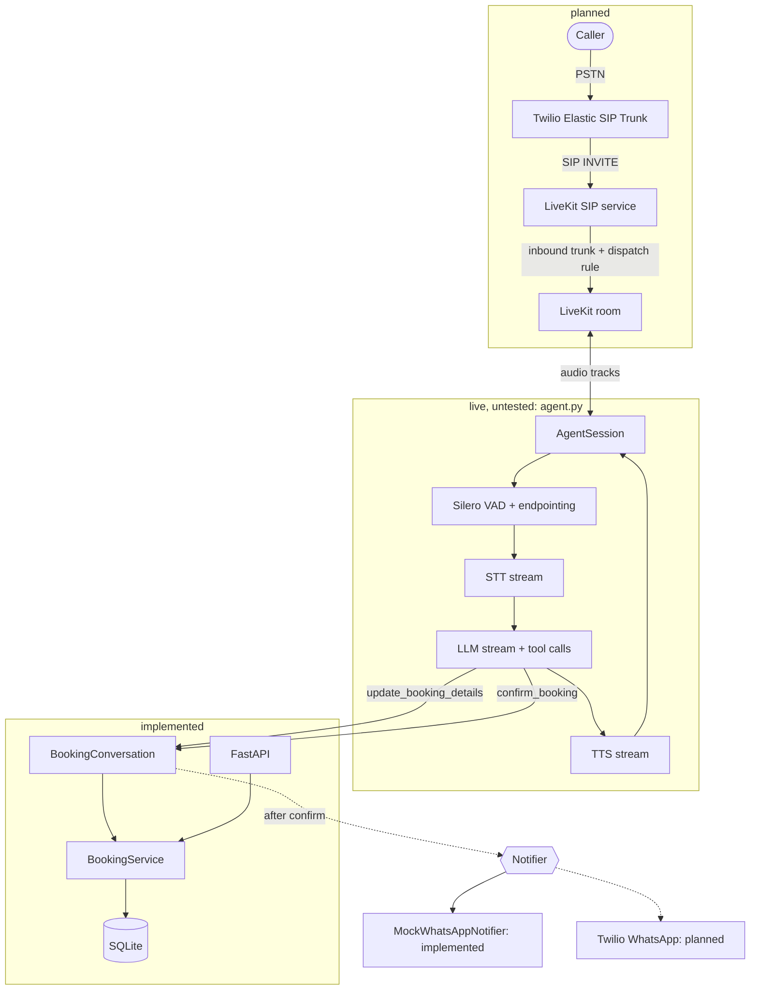

# Architecture

Legend: **[implemented]** exists and is tested here. **[live, untested]** code exists but needs external
accounts and has not been run end to end. **[planned]** design only.

## Incoming telephony and SIP routing [planned]

Intended path: a business number on Twilio, an Elastic SIP trunk whose origination URI points at a LiveKit SIP
endpoint, a LiveKit **inbound trunk** that accepts that number, and a **dispatch rule** that places each call in
its own room (typically one room per call) and dispatches the agent into it. The caller then appears in the room as a SIP
participant, and the agent talks to them like any other participant. Exact fields and URIs change between
releases, so follow the current LiveKit SIP and Twilio trunking docs when implementing. Nothing in this
repository configures telephony yet. Phone audio is narrowband (8 kHz G.711 over most PSTN legs), which affects STT accuracy
and is one reason to evaluate STT on real call audio, not on studio recordings.

## LiveKit voice agent lifecycle [live, untested]

`agent.py` defines an `AgentServer` (the worker). Its flow:

1. The worker registers with LiveKit and waits for jobs. At process start, `prewarm` loads the Silero VAD model once.
2. When a room needs an agent, the server runs `entrypoint(ctx)` in a job process.
3. `entrypoint` builds an `AgentSession` from the configured STT, LLM and TTS plus the prewarmed VAD, then
   starts a `Receptionist` agent in `ctx.room`. A fresh `Receptionist` means a fresh `BookingConversation`, so state is
   per call and never shared.
4. The agent greets via `generate_reply`, then the session loop runs until the participant leaves.

## Streaming STT → LLM → TTS

Each stage streams: STT emits interim and final transcripts, the LLM streams tokens (and tool calls), and TTS
starts synthesising from the first sentences without waiting for the full reply. `AgentSession` wires these
stages together; this project does not reimplement them. The latency consequences are in
[LATENCY.md](LATENCY.md).

## VAD and endpointing

Silero VAD detects speech start and stop. **Endpointing** decides when a pause means the caller has finished
their turn. The SDK supports a minimum and maximum endpointing delay and optional model-based turn detection. This
project currently leaves these at SDK defaults. Tuning is a roadmap item: callers who are reading out a phone
number pause between digit groups, and an endpoint that fires too early will cut them off.

## Interruption handling

`allow_interruptions=True` is set explicitly. When VAD detects the caller speaking over the agent, the session
stops TTS playback and starts a new user turn. Two things to evaluate on real calls: false interruptions
(coughs, line noise, "haan" back-channels) and what the LLM believes it already said when it was cut off.
The SDK has options for both; none are tuned here.

## Hindi-English code-switching considerations

- **STT**: one language setting per stream. The default here is `language="hi"` as an untested starting point.
  Output script varies by provider (Devanagari vs romanised), so downstream code must not assume one script.
  Compare providers on an evaluation set of real Hinglish call audio before choosing.
- **LLM**: the system prompt tells it to reply in the caller's language. Tool arguments are always normalised
  (ISO times, canonical service names, `+91` phone), so the booking layer never parses free-form Hindi.
- **TTS**: check how the chosen voice pronounces English words inside Hindi sentences, numbers, and phone digits.
  Reading the phone number back in groups is safer than as one long number.
- **Time expressions**: "kal", "parso", "saade chaar baje", "shaam ko" are ambiguous. The LLM resolves them using
  the current date and time injected in its prompt; deterministic validation then catches impossible results
  (past, closed, outside hours), and the read-back step gives the caller a chance to correct.

## Structured conversation state

`BookingConversation` (`dialogue.py`) holds a draft of four fields: name, phone, service, time. The LLM calls
`update_booking_details` with only the fields that changed. Each field is normalised on entry; invalid values are
rejected with a message the LLM can read aloud and the previous valid value is kept. The tool result tells the LLM
what is still missing, or, when complete and valid, supplies the text to read back. A correction after the
read-back simply overwrites the field and produces a new read-back. After `confirm_booking` succeeds the draft is
locked and a repeat call returns the same appointment instead of creating a duplicate.

## Appointment validation

Layered, all in plain Python:

1. **Shape** (Pydantic models): name length, Indian mobile number normalised to `+91XXXXXXXXXX`.
2. **Business rules** (`BookingService.validate`): known service, not in the past, open that weekday, and the
   service duration fits inside opening hours on the same day.
3. **Availability** (`BookingService.create`): inside a `BEGIN IMMEDIATE` SQLite transaction, count overlapping
   booked appointments and reject if at the business's `capacity`. The check and insert are atomic, so two
   simultaneous calls cannot take the same slot.

## WhatsApp notification workflow

After a booking is saved, a `Notifier` sends the confirmation. Today that is `MockWhatsAppNotifier`, which records
and logs the message. The planned Twilio implementation should use pre-approved message templates for business-initiated messages
(WhatsApp restricts free-form messages outside a customer-initiated window), run the blocking client in a thread, and
treat failure as non-fatal: the booking is already saved, and both the agent and API swallow and log notification errors.
Retries and delivery status are not designed yet.

## Security and privacy considerations

- **Personal data**: names and phone numbers are stored in plaintext SQLite. Before any real deployment: encryption at rest,
  retention limits, and a consent/disclosure line at the start of calls. Review India's DPDP Act obligations with qualified advice.
- **Secrets**: only from environment variables; `.env` is git-ignored; `.env.example` contains no values.
- **LLM boundary**: the LLM cannot touch the database directly. It can only call two tools, both validated, so a prompt injection by a caller
  cannot do more than create or fail to create a booking with validated fields. It could still talk the agent into
  saying wrong things, so the prompt forbids guessing business facts.
- **Logging**: the mock notifier logs phone numbers. Do not ship that logging to production.
- **API**: no authentication or rate limiting yet; run it only on localhost until that is added.
- **Third parties**: audio and transcripts go to the chosen STT/LLM/TTS vendors. Check their data-retention terms.
